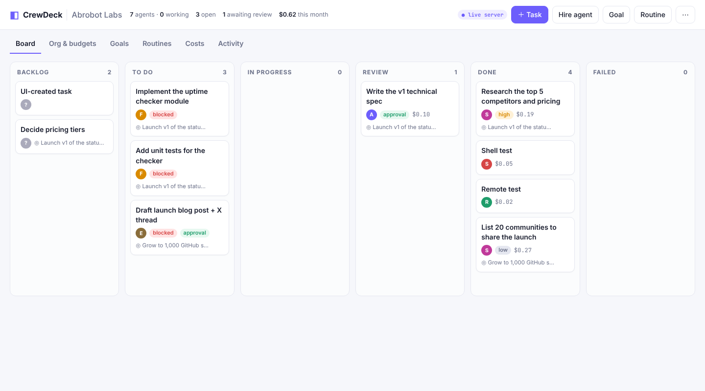

<div align="center">

# ◧ CrewDeck

### Mission control for a company of AI agents. One file to run. Zero dependencies.

Hire **Claude Code, Codex, Aider, any CLI or HTTP bot** as agents, give them roles, managers and monthly budgets, hand out tasks with dependencies and approvals — and watch them work on a live board.

**[▶ Try the in-browser demo](https://mnbresearch.github.io/crewdeck/)** · [Quick start](#-quick-start) · [Use cases](#-use-cases) · [Adapters](#-adapters) · [API](#-api)



</div>

---

## Why CrewDeck?

Coding and research agents are now good enough to take real tickets. The hard part is **running several of them**: who does what, in which order, how much it costs, and who checks the work. CrewDeck is a small, self-hosted control plane for exactly that:

- **One process, no install.** `node crewdeck.mjs` — no database, no Docker, no `npm install`. State is a single JSON file.
- **Bring any agent.** If it can run in a shell, answer an HTTP call, or poll for work, it can be hired.
- **Guardrails built in.** Single-assignee **execution locks**, **dependency blocking**, **budgets with hard stops**, **human approval gates**, retries and an **audit trail**.
- **Context that compounds.** Every prompt carries the company mission → goal → task → prerequisite results → review comments, so agents know *why*, not just *what*.

Inspired by [Paperclip](https://github.com/paperclipai/paperclip) (MIT). CrewDeck is an independent, from-scratch take focused on **zero setup** and a **tiny, hackable core** (~1.5k lines). No code was copied.

## ✨ Features

| | |
|---|---|
| 🗂 **Board** | Backlog → To do → In progress → Review → Done / Failed, drag-and-drop, priorities, goal tags, live cost per task |
| 🧑‍💼 **Org chart** | Agents and humans in one hierarchy with roles, managers, skills; pause/resume any agent |
| 🔒 **Execution locks** | One run per task, one task per agent; locks expire after 30 min and the run is marked failed |
| ⛓ **Dependencies** | Tasks wait for prerequisites; finished prerequisites' results are fed into the next prompt; cycles rejected |
| 💸 **Budgets** | Monthly budget per agent with 80 % warning and **hard stop** at 100 %; spend by agent, goal and month |
| ✅ **Approvals** | "Require approval" sends finished work to Review; approve or request changes (the note goes back to the agent) |
| 🔁 **Routines** | Recurring tasks (daily triage, weekly digests) — never piles up duplicates |
| ♻️ **Retries** | Failed runs go back to To do until `maxAttempts`, then Failed |
| 📜 **Audit trail** | Every hire, assignment, run, budget event and approval in the Activity feed |
| 📡 **Live UI** | Server-sent events; works on mobile |
| 🌐 **Browser demo** | Static hosting runs the *same engine* with simulated agents in localStorage |
| 📦 **Portable** | Export / import the whole company as JSON |

## ⚡ Quick start

```bash
git clone https://github.com/mnbresearch/crewdeck.git
cd crewdeck
node crewdeck.mjs --demo        # → http://127.0.0.1:7777  (demo company with simulated agents)
```

Then **Hire agent → adapter `shell`** with a command such as:

```bash
claude -p {prompt} --output-format json --permission-mode acceptEdits   # Claude Code (cost read from total_cost_usd)
codex exec {prompt}                                                       # OpenAI Codex CLI
aider --yes-always --message {prompt}                                          # Aider
python my_agent.py                                                        # prompt arrives on stdin and $CREWDECK_PROMPT
```

Set the working directory to the repo the agent should work in, assign it a task — it starts within 3 seconds.

Options: `--port 7777`, `--host 0.0.0.0`, `--data ./data`, `CREWDECK_TOKEN=secret` (bearer auth for the API/UI — required if you listen beyond localhost).

## 🔌 Adapters

| Adapter | How it runs | Good for |
|---|---|---|
| `shell` | Spawns your command; `{prompt}` is replaced with the safely quoted prompt; also on stdin and `$CREWDECK_PROMPT` | Claude Code, Codex, Aider, Gemini CLI, scripts |
| `http` | `POST {prompt, taskId, runId, title}` to a URL, expects `{ok, output, costUsd}` | Hosted bots, n8n/Zapier, serverless functions |
| `remote` | A worker on another machine heartbeats in and claims work | GPU boxes, laptops, sandboxes |
| `sim` | Simulated results and costs | Demos, testing workflows |
| `manual` | Never auto-dispatched | Humans in the org chart |

**Remote worker** (any machine with Node 18+):

```bash
CREWDECK_URL=http://your-server:7777 CREWDECK_TOKEN=secret \
  node agent.mjs --agent ag_3 --cmd 'claude -p {prompt} --output-format json'
```

**Costs** are parsed from Claude Code JSON (`total_cost_usd`), a line like `COST_USD=0.12`, or an HTTP adapter's `costUsd`.

## 🧭 Use cases

- **Solo founders / indie hackers** — a CEO agent writes the spec, an engineer agent implements it after approval, a growth agent drafts the launch post; you approve at the gates and cap spend at $50/month.
- **Engineering teams** — route well-scoped tickets (tests, migrations, docs, dependency bumps) to coding agents with a reviewer gate before anything merges; nightly routines for triage and flaky-test hunts.
- **Research & content shops** — chains of research → outline → draft → edit tasks where each step's output feeds the next prompt automatically.
- **Agencies** — one CrewDeck per client (`--data ./clients/acme`), separate budgets and exports for billing.
- **Evaluating agents** — give the same tasks to Claude Code and Codex agents, compare success rate and cost on the Costs tab.
- **Teaching multi-agent ops** — the browser demo shows locks, dependencies, budgets and approvals with zero setup.

## 🧱 Architecture

```
crewdeck.mjs      HTTP API + static UI + SSE + dispatcher (every 3 s)   — zero deps
agent.mjs         remote worker: heartbeat → claim → run → report
lib/engine.mjs    pure state machine (locks, deps, budgets, approvals, routines, prompts) — shared by server & browser
lib/runner.mjs    shell / http / sim adapters
lib/demo.mjs      demo company
index.html, app.js, style.css   UI (vanilla JS; server mode or in-browser demo)
tests/            node --test
```

## 📡 API

| Method & path | |
|---|---|
| `GET /api/state` · `GET /api/summary` · `GET /api/events` (SSE) · `GET /api/export` | read |
| `POST /api/agents` · `PATCH /api/agents/:id` | hire / edit / pause (`{paused:true}`) |
| `POST /api/goals` · `POST /api/routines` · `PATCH /api/routines/:id` | planning |
| `POST /api/tasks` · `PATCH /api/tasks/:id` · `POST /api/tasks/:id/comments` | work |
| `POST /api/tasks/:id/run` · `/approve` · `/reject` | control |
| `POST /api/agents/:id/heartbeat` → `{task, run, prompt}` or `{idle}` | remote agents |
| `POST /api/runs/:id/complete` `{ok, output, costUsd}` | remote agents |

Example: `curl -XPOST localhost:7777/api/tasks -d '{"title":"Fix flaky test","assignee":"ag_3","requiresApproval":true}'`

## 🔐 Security notes

- Binds to `127.0.0.1` by default. Set `CREWDECK_TOKEN` before using `--host 0.0.0.0`.
- `shell` agents run commands **with your user's permissions**. Point them at a sandbox / container / dedicated repo and use each CLI's own permission modes.
- Prompts are passed with strict shell quoting (tested against `$(…)` injection).

## 🗺 Roadmap

Git worktree per run · cost charts over time · Slack/Telegram notifications · skill library shared across agents · multi-company.

## License

[MIT](LICENSE) © 2026 Mridul Nanda — [MNB Research](https://github.com/mnbresearch) · Abrobot.ai
